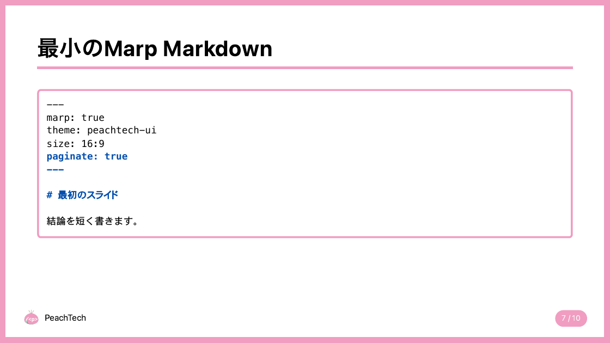

# 通常スライド

- 見出しは結論が分かる言葉にする
- 箇条書きは3〜5項目に絞る
- 強調する箇所を**1つ**決める

---

# 2カラム

<div class="columns">
<div class="column">

## 課題

- 手作業が多い
- 再現しにくい

</div>
<div class="column">

## 改善

- 自動化する
- 手順を共有する

</div>
</div>

---

# 画像中心

<div class="image-center">


</div>

画像の意味を一文で補足します。

---

<!-- _class: code-focus -->

# コード中心

```ts
const message = 'Hello, PeachTech!';

function present(text: string): void {
  console.log(text);
}

present(message);
```

---

# 比較

<div class="columns compare">
<div class="column">

## Before

- 手順が人ごとに違う
- 出力にばらつきがある

</div>
<div class="column">

## After

- 手順をREADMEに集約
- テーマで見た目を統一

</div>
</div>

---

<!-- _class: section -->
<!-- _paginate: false -->

# セクション区切り

ここから新しい話題です

---

<!-- _class: layout layout-question -->
<!-- 02 問いかけ -->

# 資料の修正に何分かかる？

サークルのLT資料づくりを短くする方法を考えます。

---

<!-- _class: layout -->
<!-- 04 現在地付き目次。説明中の項目に aria-current="step" を付けます。 -->

# 今日の流れ

<ol class="agenda-steps">
  <li class="layout-panel">
    <span class="layout-label">01</span>
    <h2>課題</h2>
    <p>手作業が多い場面</p>
  </li>
  <li class="layout-panel" aria-current="step">
    <span class="layout-label">02・説明中</span>
    <h2>設計</h2>
    <p>原稿から出力まで</p>
  </li>
  <li class="layout-panel">
    <span class="layout-label">03</span>
    <h2>検証</h2>
    <p>導入前後の計測</p>
  </li>
</ol>

---

<!-- _class: layout -->
<!-- 05 プロフィール -->

# 自己紹介

<div class="profile">
  
  <div>
    <h2>山田 直樹</h2>
    <p>大学2年・技術サークル所属</p>
    <p class="layout-note">LT運営を担当。発表資料の作り方をチームで揃えています。</p>
  </div>
</div>

---

<!-- _class: layout -->
<!-- 06 用語カード -->

# スライドの用語

<div class="layout-grid layout-grid--wide-right">
  <strong class="term">Frontmatter</strong>
  <div class="layout-stack">
    <div class="definition">
      <h2>定義</h2>
      <p>Markdownファイルの先頭に書く設定欄。</p>
    </div>
    <div class="definition">
      <h2>具体例</h2>
      <p><code>theme: peachtech-ui</code> で全体のテーマを指定します。</p>
    </div>
  </div>
</div>

---

<!-- _class: layout layout-quote -->
<!-- 07 引用フォーカス -->

# 原稿を作るときの方針

<figure>
  <blockquote>
    <p>5分発表では情報量を抑え、1スライド1メッセージを基本にする。</p>
  </blockquote>
  <figcaption>出典　<code>AGENT.md</code>「作業ルール」</figcaption>
</figure>

<p class="layout-note">詳細な手順は発表者ノートに回します。</p>

---

<!-- _class: layout -->
<!-- 09 入力 → 処理 → 出力 -->

# 原稿から提出用PDFができるまで

<div class="layout-flow">
  <div class="layout-panel">
    <span class="layout-label">入力</span>
    <h2>原稿</h2>
    <p><code>slides.md</code></p>
  </div>
  <span class="layout-arrow" aria-hidden="true">→</span>
  <div class="layout-panel layout-panel--accent">
    <span class="layout-label">処理</span>
    <h2>Marp CLI</h2>
    <p>テーマを適用</p>
  </div>
  <span class="layout-arrow" aria-hidden="true">→</span>
  <div class="layout-panel">
    <span class="layout-label">出力</span>
    <h2>配布資料</h2>
    <p><code>dist/slides.pdf</code></p>
  </div>
</div>

---

<!-- _class: layout -->
<!-- 10 システム構成図 -->

# 資料のプレビューと書き出し

<div class="architecture">
  <div class="layout-panel">
    <span class="layout-label">利用者</span>
    <h2>発表者</h2>
    <p>原稿を編集</p>
  </div>
  <span class="layout-arrow" aria-hidden="true">→</span>
  <div class="layout-panel architecture-group">
    <h2>ローカル環境</h2>
    <div class="layout-flow">
      <div class="layout-panel">
        <h2>VS Code</h2>
        <p>プレビュー</p>
      </div>
      <span class="layout-arrow" aria-hidden="true">／</span>
      <div class="layout-panel layout-panel--accent">
        <h2>Marp CLI</h2>
        <p>書き出し</p>
      </div>
    </div>
  </div>
  <span class="layout-arrow" aria-hidden="true">→</span>
  <div class="layout-panel">
    <span class="layout-label">共有先</span>
    <h2>提出フォルダ</h2>
    <p>完成版を配布</p>
  </div>
</div>

---

<!-- _class: layout -->
<!-- 11 レイヤー構成 -->

# スライドを構成する3つの層

<div class="layer-stack">
  <div class="layout-panel layer"><strong>表示</strong><span>テーマCSSで配色・文字サイズ・余白を決める</span></div>
  <div class="layout-panel layer"><strong>変換</strong><span>MarpがMarkdownをスライドに組み立てる</span></div>
  <div class="layout-panel layer"><strong>コンテンツ</strong><span>Markdownの本文と画像が発表内容を持つ</span></div>
</div>

---

<!-- _class: layout -->
<!-- 12 スイムレーン。--step は担当欄を含むグリッド列番号です。 -->

# 発表者と変換ツールの作業分担

<div class="swimlane">
  <div class="swimlane-row">
    <strong class="swimlane-owner">発表者</strong>
    <div class="layout-panel swimlane-task" style="--step: 2">
      原稿を保存
      <span class="layout-arrow swimlane-down" aria-hidden="true">↘</span>
    </div>
    <div class="layout-panel swimlane-task" style="--step: 5">PDFを確認</div>
  </div>
  <div class="swimlane-row">
    <strong class="swimlane-owner">Marp CLI</strong>
    <div class="layout-panel swimlane-task" style="--step: 3">
      原稿を変換
      <span class="layout-arrow" aria-hidden="true">→</span>
    </div>
    <div class="layout-panel swimlane-task" style="--step: 4">
      PDFを保存
      <span class="layout-arrow swimlane-up" aria-hidden="true">↗</span>
    </div>
  </div>
</div>

---

<!-- _class: layout -->
<!-- 13 シーケンス図。--step は行番号、--participants は矢印がまたぐ列の範囲です。 -->

# PDF書き出しのリクエストと応答

<div class="sequence">
  <strong class="layout-panel layout-panel--accent sequence-participant">発表者</strong>
  <strong class="layout-panel layout-panel--accent sequence-participant">Marp CLI</strong>
  <strong class="layout-panel layout-panel--accent sequence-participant">ブラウザー</strong>
  <span class="sequence-lifeline" style="--participant: 1" aria-hidden="true"></span>
  <span class="sequence-lifeline" style="--participant: 2" aria-hidden="true"></span>
  <span class="sequence-lifeline" style="--participant: 3" aria-hidden="true"></span>
  <p class="sequence-message" style="--participants: 1 / 3; --step: 2">PDF書き出しを指示</p>
  <p class="sequence-message" style="--participants: 2 / 4; --step: 3">スライドの印刷を要求</p>
  <p class="sequence-message sequence-return" style="--participants: 2 / 4; --step: 4">PDFデータを返す</p>
  <p class="sequence-message sequence-return" style="--participants: 1 / 3; --step: 5">保存先を表示</p>
</div>

---

<!-- _class: layout -->
<!-- 14 条件分岐ツリー -->

# 資料は提出できる状態か？

<div class="decision-tree">
  <strong class="layout-panel layout-panel--accent">プレビューで崩れがある？</strong>
  <div class="decision-branches">
    <div class="decision-branch">
      <span class="layout-label">はい</span>
      <div class="layout-panel">原稿や画像サイズを調整する</div>
    </div>
    <div class="decision-branch">
      <span class="layout-label">いいえ</span>
      <div class="layout-panel">提出用ファイルを書き出す</div>
    </div>
  </div>
</div>

---

<!-- _class: layout -->
<!-- 15 状態遷移図 -->

# 書き出しジョブの状態

<div class="layout-flow state-flow">
  <strong class="layout-panel">待機</strong>
  <span class="state-edge">実行指示<span class="layout-arrow" aria-hidden="true">→</span></span>
  <strong class="layout-panel layout-panel--accent">変換中</strong>
  <span class="state-edge">保存成功<span class="layout-arrow" aria-hidden="true">→</span></span>
  <strong class="layout-panel">完了</strong>
  <div class="state-failure">
    <span class="state-edge">変換エラー<span class="layout-arrow" aria-hidden="true">↓</span></span>
    <strong class="layout-panel">失敗</strong>
  </div>
</div>

---

<!-- _class: layout -->
<!-- 16 データモデル図 -->

# LT管理のデータモデル

<div class="entity-diagram">
  <div class="layout-panel">
    <h2>発表者</h2>
    <ul class="entity-fields"><li>発表者ID</li><li>表示名</li></ul>
  </div>
  <div class="entity-relation" aria-label="1人の発表者に複数の発表">
    <strong>1</strong><span aria-hidden="true"></span><strong>N</strong>
  </div>
  <div class="layout-panel layout-panel--accent">
    <h2>発表</h2>
    <ul class="entity-fields"><li>発表ID</li><li>発表者ID・イベントID</li><li>タイトル</li></ul>
  </div>
  <div class="entity-relation" aria-label="1つのイベントに複数の発表">
    <strong>N</strong><span aria-hidden="true"></span><strong>1</strong>
  </div>
  <div class="layout-panel">
    <h2>イベント</h2>
    <ul class="entity-fields"><li>イベントID</li><li>開催日</li></ul>
  </div>
</div>

---

<!-- _class: layout -->
<!-- 17 注釈付きスクリーンショット。--x と --y は画像の左上から測った位置です。 -->

# Marpの設定と本文を見分ける

<figure class="layout-grid layout-grid--wide-left annotated-figure">
  <div class="annotated-image">
    
    <span class="annotation-number" style="--x: 30%; --y: 40%" aria-hidden="true">1</span>
    <span class="annotation-number" style="--x: 27%; --y: 60%" aria-hidden="true">2</span>
  </div>
  <figcaption>
    <ol class="annotations">
      <li><span class="annotation-number" aria-hidden="true">1</span><p><strong>設定欄</strong><br>テーマやページ番号を決めます。</p></li>
      <li><span class="annotation-number" aria-hidden="true">2</span><p><strong>本文</strong><br>見出しと文章がスライドに表示されます。</p></li>
    </ol>
  </figcaption>
</figure>

---

<!-- _class: layout -->
<!-- 18 コード＋行別解説 -->

# タイトルの空白を整える

<div class="layout-grid layout-grid--wide-left code-notes">
<div class="code-listing">
<span class="code-line-numbers" aria-hidden="true">1<br>2<br>3<br>4</span>
<div>

```js
function makeTitle(name) {
  const title = name.trim();
  return title || "無題";
}
```

</div>
</div>
<div class="layout-panel">

## 注目する行

- **2行目**で前後の空白を削除
- **3行目**で既定値を返す

</div>
</div>

---

<!-- _class: layout -->
<!-- 19 コード＋実行結果 -->

# ファイル名をURL用に整形する

<div class="layout-stack code-output">
<div>

<span class="layout-label">コード</span>

```js
const filename = "Intro to Marp";
console.log(filename.toLowerCase().replaceAll(" ", "-"));
```

</div>
<div>

<span class="layout-label">実行結果</span>

```text
intro-to-marp
```

</div>
</div>

---

<!-- _class: layout -->
<!-- 20 差分フォーカス -->

# テーマを発表用に切り替える

```diff
  marp: true
- theme: default
+ theme: peachtech-ui
  size: 16:9
  paginate: true
```

<p class="layout-note">テーマの指定を変えると、共通の配色や見出しが適用されます。</p>

---

<!-- _class: layout -->
<!-- 22 ディレクトリツリー＋責務 -->

# どのファイルを編集するか

<div class="layout-grid">
<div>

```text
peachtech-presentation/
├── slides.md
├── assets/
└── themes/
    └── peachtech-ui.css
```

</div>
<dl class="directory-notes">
  <dt><code>slides.md</code></dt>
  <dd>発表の構成と本文</dd>
  <dt><code>assets/</code></dt>
  <dd>本文で使う画像</dd>
  <dt><code>themes/peachtech-ui.css</code></dt>
  <dd>共通の見た目とレイアウト</dd>
</dl>
</div>

---

<!-- _class: layout -->
<!-- 25 選択肢カード -->

# どの形式で資料を渡すか

<div class="layout-grid layout-grid--three">
  <div class="layout-panel">
    <h2>PDF</h2>
    <p>配布や提出で、同じページ構成を見せたいとき。</p>
  </div>
  <div class="layout-panel">
    <h2>PPTX</h2>
    <p>発表会場でPowerPointを使うとき。</p>
  </div>
  <div class="layout-panel">
    <h2>HTML</h2>
    <p>ブラウザーでスライドを操作したいとき。</p>
  </div>
</div>

---

<!-- _class: layout -->
<!-- 27 2×2マトリクス -->

# 改善施策を効果と工数で整理する

<div class="quadrant">
  <div class="layout-label quadrant-axis-y"><span>高</span><strong>効果</strong><span>低</span></div>
  <div class="quadrant-cells">
    <div class="quadrant-cell layout-panel--accent"><strong>最初に着手</strong><p>雛形を整える</p></div>
    <div class="quadrant-cell"><strong>計画して進める</strong><p>書き出しを自動化</p></div>
    <div class="quadrant-cell"><strong>余裕があれば</strong><p>画像名を統一</p></div>
    <div class="quadrant-cell"><strong>優先度を下げる</strong><p>素材管理ツールを自作</p></div>
  </div>
  <div class="layout-label quadrant-axis-x"><span>低</span><strong>実装工数</strong><span>高</span></div>
</div>

---

<!-- _class: layout -->
<!-- 30 選定ファネル。--width で各段の表示幅を調整します。 -->

# 発表テーマを絞り込む

<ol class="funnel">
  <li class="layout-panel" style="--width: 94%"><strong>12件</strong><span>チームが出した候補</span></li>
  <li class="layout-panel" style="--width: 74%"><strong>6件</strong><span>5分で説明できる候補</span></li>
  <li class="layout-panel" style="--width: 54%"><strong>3件</strong><span>現時点でデモできる候補</span></li>
  <li class="layout-panel layout-panel--accent" style="--width: 34%"><strong>1件</strong><span>今回の発表テーマ</span></li>
</ol>

---

<!-- _class: layout layout-metric -->
<!-- 33 単一指標。数値は説明用のサンプルです。 -->

# 提出用PDFの準備時間

<strong class="metric-value">3<small>分</small></strong>

<p class="layout-note">LT資料10枚・テンプレート導入後のサンプル計測</p>

---

<!-- _class: layout -->
<!-- 34 主指標＋補助指標。数値は説明用のサンプルです。 -->

# テンプレート導入後の作業時間

<div class="layout-grid layout-grid--wide-left">
  <div class="layout-panel layout-panel--accent metric-primary">
    <span class="layout-label">準備時間の削減率</span>
    <strong class="metric-value">70<small>%</small></strong>
    <p>1件あたり10分から3分に短縮</p>
  </div>
  <div class="layout-stack">
    <div class="layout-panel metric-secondary">
      <span class="layout-label">対象の資料</span>
      <strong>10件</strong>
    </div>
    <div class="layout-panel metric-secondary">
      <span class="layout-label">1件あたりの削減時間</span>
      <strong>7分</strong>
    </div>
  </div>
</div>

---

<!-- _class: layout -->
<!-- 35 横棒ランキング。--value は軸の上限に対する割合です。 -->

# 工程別の処理時間

<figure class="bar-chart" role="img" aria-label="書き出し80秒、画像準備60秒、原稿チェック40秒、ファイル名整理20秒">
  <div class="bar-row">
    <strong>書き出し</strong><div class="bar-track"><span class="bar-fill" style="--value: 80%"></span></div><span>80秒</span>
  </div>
  <div class="bar-row">
    <strong>画像準備</strong><div class="bar-track"><span class="bar-fill" style="--value: 60%"></span></div><span>60秒</span>
  </div>
  <div class="bar-row">
    <strong>原稿チェック</strong><div class="bar-track"><span class="bar-fill" style="--value: 40%"></span></div><span>40秒</span>
  </div>
  <div class="bar-row">
    <strong>ファイル名整理</strong><div class="bar-track"><span class="bar-fill" style="--value: 20%"></span></div><span>20秒</span>
  </div>
  <div class="bar-row" aria-hidden="true">
    <div class="bar-axis"><span>0</span><span>25</span><span>50</span><span>75</span><span>100</span></div>
  </div>
</figure>

<p class="layout-note">サンプル計測・単位は秒</p>

---

<!-- _class: layout -->
<!-- 36 推移＋イベント注釈。--week-N は縦軸の上端から測った位置です。 -->

# 書き出し時間の推移

<figure role="img" aria-label="1週目80秒、2週目72秒、3週目46秒、4週目38秒。3週目に画像を圧縮しました。">
  <p class="chart-unit">処理時間（秒）</p>
  <div class="trend-chart">
    <div class="trend-y"><span>100</span><span>75</span><span>50</span><span>25</span><span>0</span></div>
    <div class="trend-plot" style="--week-1: 20%; --week-2: 28%; --week-3: 54%; --week-4: 62%">
      <span class="trend-segment" style="--from: var(--week-1); --to: var(--week-2)"></span>
      <span class="trend-segment" style="--from: var(--week-2); --to: var(--week-3)"></span>
      <span class="trend-segment" style="--from: var(--week-3); --to: var(--week-4)"></span>
      <span class="trend-event" style="--x: 66.67%"><span>画像を圧縮</span></span>
      <span class="trend-point" style="--x: 0%; --y: var(--week-1)"><strong>80</strong></span>
      <span class="trend-point" style="--x: 33.33%; --y: var(--week-2)"><strong>72</strong></span>
      <span class="trend-point" style="--x: 66.67%; --y: var(--week-3)"><strong>46</strong></span>
      <span class="trend-point" style="--x: 100%; --y: var(--week-4)"><strong>38</strong></span>
    </div>
    <div class="trend-x"><span>1週目</span><span>2週目</span><span>3週目</span><span>4週目</span></div>
  </div>
  <figcaption class="layout-note">同じ10枚の資料を使ったサンプル計測</figcaption>
</figure>

---

<!-- _class: layout -->
<!-- 37 内訳の積み上げ棒。1本の棒で --share の合計を100%にします。 -->

# 準備時間の内訳

<figure role="img" aria-label="導入前は原稿30%、体裁45%、確認25%。導入後は原稿45%、体裁20%、確認35%。">
  <div class="stacked-chart">
    <div class="stacked-row">
      <strong>導入前</strong>
      <div class="stacked-bar">
        <span class="chart-key--solid" style="--share: 30%">30%</span>
        <span class="chart-key--striped" style="--share: 45%">45%</span>
        <span class="chart-key--outline" style="--share: 25%">25%</span>
      </div>
    </div>
    <div class="stacked-row">
      <strong>導入後</strong>
      <div class="stacked-bar">
        <span class="chart-key--solid" style="--share: 45%">45%</span>
        <span class="chart-key--striped" style="--share: 20%">20%</span>
        <span class="chart-key--outline" style="--share: 35%">35%</span>
      </div>
    </div>
  </div>
  <ul class="chart-legend">
    <li><span class="chart-swatch chart-key--solid" aria-hidden="true"></span>原稿</li>
    <li><span class="chart-swatch chart-key--striped" aria-hidden="true"></span>体裁</li>
    <li><span class="chart-swatch chart-key--outline" aria-hidden="true"></span>確認</li>
  </ul>
  <figcaption class="layout-note">各条件における時間の割合・サンプル計測</figcaption>
</figure>

---

<!-- _class: layout -->
<!-- 38 分布＋外れ値。--value は横軸の上限に対する割合、--row は重なりを避ける縦位置です。 -->

# プレビュー更新時間のばらつき

<figure class="dot-chart" role="img" aria-label="更新時間は8秒台から11秒台に集中し、1件だけ17.6秒でした。">
  <p class="chart-unit">更新時間（秒）</p>
  <div class="dot-plot">
    <span class="dot-point" style="--value: 41%"></span>
    <span class="dot-point" style="--value: 44%; --row: 46px"></span>
    <span class="dot-point" style="--value: 46%; --row: 70px"></span>
    <span class="dot-point" style="--value: 48%"></span>
    <span class="dot-point" style="--value: 49%; --row: 46px"></span>
    <span class="dot-point" style="--value: 53%"></span>
    <span class="dot-point" style="--value: 55%; --row: 46px"></span>
    <span class="dot-point" style="--value: 57%"></span>
    <span class="dot-point dot-outlier" style="--value: 88%"><strong>17.6秒・初回起動</strong></span>
  </div>
  <div class="dot-axis"><span>0</span><span>5</span><span>10</span><span>15</span><span>20</span></div>
  <figcaption class="layout-note">1点が1回のサンプル計測を表します。</figcaption>
</figure>

---

<!-- _class: layout -->
<!-- 39 計測条件＋グラフ。--value は軸の上限に対する割合です。 -->

# 画像を圧縮したときの書き出し時間

<div class="layout-grid layout-grid--wide-right">
  <div class="layout-panel">
    <h2>計測条件</h2>
    <ul>
      <li>macOS・Node.js 22</li>
      <li>スライド10枚</li>
      <li>5回の中央値</li>
    </ul>
  </div>
  <figure class="bar-chart" role="img" aria-label="圧縮前80秒、圧縮後38秒。数値はサンプルです。">
    <div class="bar-row">
      <strong>圧縮前</strong><div class="bar-track"><span class="bar-fill" style="--value: 80%"></span></div><span>80秒</span>
    </div>
    <div class="bar-row">
      <strong>圧縮後</strong><div class="bar-track"><span class="bar-fill" style="--value: 38%"></span></div><span>38秒</span>
    </div>
    <div class="bar-row" aria-hidden="true">
      <div class="bar-axis"><span>0</span><span>25</span><span>50</span><span>75</span><span>100</span></div>
    </div>
    <figcaption class="layout-note">サンプル計測・単位は秒</figcaption>
  </figure>
</div>

---

<!-- _class: layout -->
<!-- 40 テスト結果ヒートマップ。セルのクラスと結果の文言を一緒に変えます。 -->

# ブラウザー別の表示テスト

<table class="test-heatmap">
  <thead>
    <tr><th scope="col">テスト項目</th><th scope="col">Chrome</th><th scope="col">Firefox</th><th scope="col">Safari</th></tr>
  </thead>
  <tbody>
    <tr><th scope="row">スライドを開く</th><td class="test-pass">合格</td><td class="test-pass">合格</td><td class="test-pass">合格</td></tr>
    <tr><th scope="row">キーボードで送る</th><td class="test-pass">合格</td><td class="test-pass">合格</td><td class="test-fail">要修正</td></tr>
    <tr><th scope="row">全画面で発表する</th><td class="test-pass">合格</td><td>未確認</td><td class="test-pass">合格</td></tr>
  </tbody>
</table>

<p class="layout-note">結果の表記例です。各ブラウザーの実測結果に差し替えてください。</p>

---

<!-- _class: layout -->
<!-- 42 マイルストーン -->

# LT当日までのスケジュール

<ol class="milestones">
  <li><time datetime="2026-05-08">5/8</time><h2>構成を確定</h2><p>各見出しが揃う</p></li>
  <li><time datetime="2026-05-15">5/15</time><h2>レビュー</h2><p>指摘への対応が完了</p></li>
  <li><time datetime="2026-05-22">5/22</time><h2>リハーサル</h2><p>5分でデモまで通す</p></li>
  <li><time datetime="2026-05-29">5/29</time><h2>本番</h2><p>発表と資料共有が完了</p></li>
</ol>

---

<!-- _class: layout -->
<!-- 47 FAQ -->

# 資料作成でよくある質問

<dl class="faq">
  <div class="layout-panel">
    <dt>発表ノートはどこに書きますか？</dt>
    <dd>対応するスライドのMarkdownに、HTMLコメントとして書きます。</dd>
  </div>
  <div class="layout-panel">
    <dt>チームに見てもらうときは何を送りますか？</dt>
    <dd>原稿の確認にはMarkdown、表示の確認にはPDFを共有します。</dd>
  </div>
  <div class="layout-panel">
    <dt>画像はどこに置きますか？</dt>
    <dd><code>assets/</code> に置き、原稿から相対パスで参照します。</dd>
  </div>
</dl>

---

<!-- _class: layout -->
<!-- 48 リンク・QRコード。リンク先を変更するときはQR画像も差し替えます。 -->

# テンプレートと使い方

<div class="layout-grid layout-grid--wide-left resource-links">
  <ul>
    <li><a href="https://github.com/HikariTakahashi/peachtech-presentation">PeachTechのMarpテンプレート</a></li>
    <li><a href="https://github.com/HikariTakahashi/peachtech-presentation#readme">セットアップと書き出しの手順</a></li>
    <li><a href="https://github.com/HikariTakahashi/peachtech-presentation/tree/HEAD/template">サンプル原稿とレイアウト集</a></li>
  </ul>
  <figure class="resource-qr">
    
    <figcaption>テンプレートを開く</figcaption>
  </figure>
</div>
